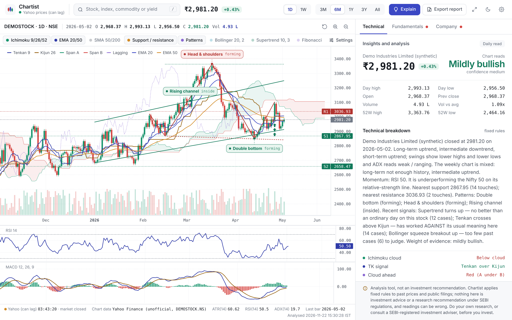

# Chartist (India)

A free, local chart-analysis workstation for Indian markets. Search any NSE or BSE stock, a Nifty or Sensex index, a global commodity or a US Treasury yield. Chartist reads the chart the way a chartist would, then shows **how each signal has actually behaved on that same security in the past**, including when it has not worked.

It runs on your own computer with the Python standard library: no account, no broker login, no API key, no data sent anywhere except the price and filing requests to Yahoo, NSE and BSE.

> **Analysis tool, not an investment recommendation.** Nothing here is investment advice or a research recommendation under SEBI regulations. Read [DISCLAIMER.md](DISCLAIMER.md).


<sub>Screenshot uses synthetic prices for a made-up company, not real market data.</sub>

## The honest part

Most chart tools hand you "Bullish" and stop there. Chartist checks itself.

**Every signal carries its own track record on the security you are looking at.** A MACD cross or a Supertrend flip is shown next to what happened after past occurrences on that stock (5, 20 and 60 bars later) compared with an ordinary stretch. Signals that have worked against their textbook meaning are labelled that way.

**The overall verdict was calibrated, and the result is published.** Across 3,474 point-in-time readings on 49 Nifty 50 stocks from 2016 to 2026 (default settings, `chartist/calibrate.py`), stocks the verdict read as bullish did **not** beat those it read as bearish: the gap over the next 60 days was −0.3 points (−0.7 and +0.1 in the two halves of the period). So the app labels the verdict as a description of the chart, not a forecast. Re-run the calibration yourself with `python chartist/calibrate.py --fetch`.

## What it does

- **Universe:** every NSE equity (main board and SME), every BSE equity (BSE-only companies listed once, dual listings matched by ISIN), Nifty 50 / 100 / Bank / IT, Sensex, and about 34 global series from Yahoo: Brent, WTI, natural gas, gold, silver, copper, aluminium, grains and softs, US T-bill / 5Y / 10Y / 30Y yields, Treasury futures, DXY, USD/INR. Any other Yahoo ticker can be typed as is (`^GSPC`, `HG=F`).
- **Technical tab:** trend on daily and weekly bars, support and resistance zones with touch counts, RSI, MACD, Stochastic, ADX, ATR, Bollinger Bands, Supertrend, Ichimoku, volume and OBV, relative strength against the Nifty 50, candlestick patterns, classical chart patterns (double tops and bottoms, head and shoulders, triangles, channels, flags) with status and key line, and a scorecard that rates each indicator out of 10 with a separate reliability on that security. There is deliberately no total score.
- **Fibonacci that follows the chart:** drawn from the highest high and lowest low in view and redrawn as you pan or zoom, or from the last major swing, or between two bars you click. Optional 127.2% and 161.8% extensions.
- **Your own indicator settings:** EMA, SMA, Bollinger, RSI, MACD, Stochastic, Supertrend, ATR, ADX and Ichimoku periods. Signals and track records are recomputed on them, and the app tells you when custom settings take you outside what was calibrated.
- **Fundamentals tab:** read from the company's own NSE filings (quarterly XBRL results, shareholding, promoter pledge, corporate actions): valuation against the company's own history, quality and growth (or a bank view for lenders), and red-flag checks marked Clear, Watch or Red.
- **Company tab:** NSE sector and industry classification, index memberships, F&O eligibility, ASM/GSM surveillance, price band, listing details, plus a business summary, website and key people.
- **Explain** gives a plain-language walk-through of the chart. **Export report** saves a self-contained HTML report you can print to PDF.
- Light and dark themes; works offline from cached data.

## Install and run

You need Python 3.10 or newer. There is nothing to `pip install`.

```bash
git clone https://github.com/adityasingh1004/chartist-india.git
cd chartist-india
```

- **Windows:** double-click `run.bat`, or run `py chartist\app.py`
- **macOS / Linux:** `./run.sh`, or `python3 chartist/app.py`

Your browser opens at http://127.0.0.1:8765. The first start downloads the NSE and BSE symbol lists (this can take a minute); after that they refresh weekly. Options: `--port 8800`, `--no-browser`, `--offline <folder>`.

### Command line and AI agents

```bash
python chartist/cli.py RELIANCE            # plain-text chart read
python chartist/cli.py "nifty bank" --tf W  # weekly read of an index
python chartist/cli.py BZ=F --json         # Brent crude, full JSON
python chartist/cli.py TCS --company       # company information
```

`skill/chartist/SKILL.md` is a Claude skill that wraps the command line. Copy the `skill/chartist` folder into your Claude skills folder (for Claude Code: `~/.claude/skills/`), keep this repository on your computer, and ask Claude to "analyse the chart of HDFC Bank".

## Data sources and their limits

| What | Source | Notes |
|---|---|---|
| Daily prices, quotes, global series | Yahoo Finance chart API | Unofficial, free, can lag; up to 10 years cached locally |
| Symbol lists | NSE equity lists, BSE scrip list | Unofficial download paths that can change |
| Results, shareholding, pledges, company classification | nseindia.com JSON used by its own pages | Primary source, but unofficial and rate-limited |
| Business summary, officers | Yahoo profile | A data vendor's text, not the company's filing |

Every endpoint and field name is marked UNVERIFIED in the code: when a site changes, a fetch fails loudly instead of guessing. Using these sites is subject to their own terms of use. This repository does not ship any market data; everything is fetched by your copy, on your computer, into `chartist/cache/` and `chartist/fundcache/` (both git-ignored).

Known gaps: no Indian G-Sec yields (Yahoo does not carry them); futures (`=F`) are Yahoo's front-month continuous series, so roll dates show jumps that are not real gaps; stocks with fewer than 80 trading days of history cannot be read yet; Fundamentals covers NSE-listed companies only.

Web fonts (IBM Plex) load from Google Fonts; without internet the page falls back to system fonts. The chart library, [TradingView Lightweight Charts](https://github.com/tradingview/lightweight-charts) (Apache-2.0), is bundled.

## Project layout

```
chartist/
  app.py           local web server and API
  engine.py        indicators, patterns, signals and their track records
  fundamentals.py  NSE filings: results XBRL, shareholding, pledges, red flags
  company.py       Company tab data
  universe.py      NSE + BSE + global search lists
  calibrate.py     point-in-time check of the verdict
  cli.py           command-line front end
  static/          the page (single HTML file) and bundled chart library
  data/            globals.json (editable list of global tickers), Nifty 500 fallback list
common/            IST clock, Yahoo fetch and cache format, NSE website client
skill/chartist/    Claude skill wrapper
tests/             offline tests on synthetic prices: python -m unittest discover tests
```

## Contributing

Issues and pull requests are welcome, especially:

- fixes when an NSE, BSE or Yahoo field changes (please attach the raw response: `python chartist/company.py SYMBOL --raw` or `python chartist/fundamentals.py SYMBOL --save probe --tags`);
- calibration runs on wider universes (Nifty 500, small caps) or on commodities and yields;
- new indicators or patterns, each with its own track record.

Please keep the rules the project runs on: standard library only, no order placement, every data point traceable to a source, and say plainly when something has not worked.

## Licence

MIT, see [LICENSE](LICENSE). Author: Aditya Kumar Singh.
